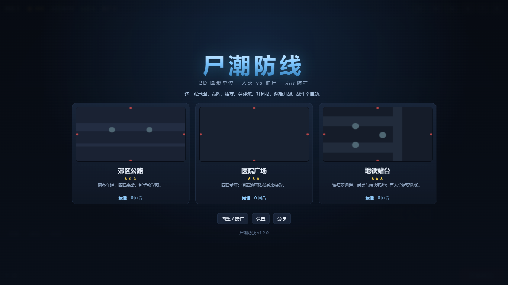
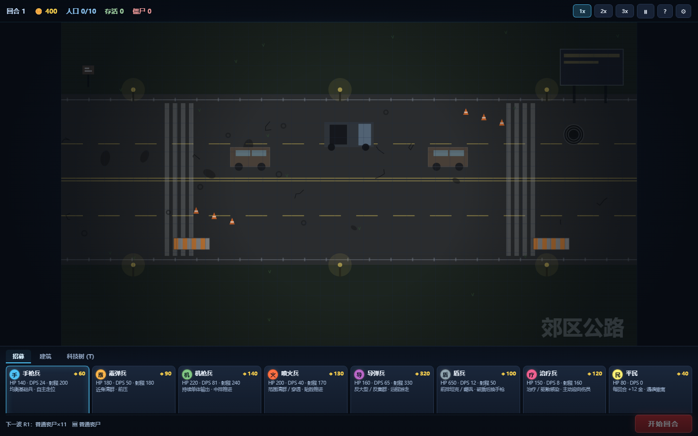
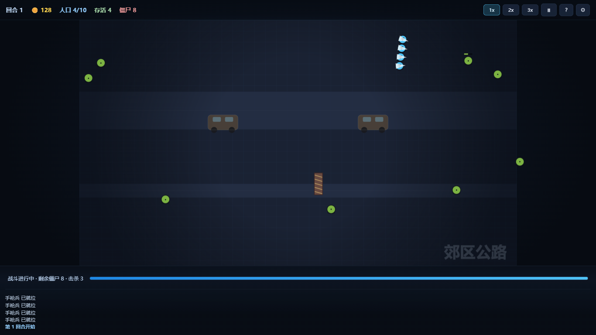
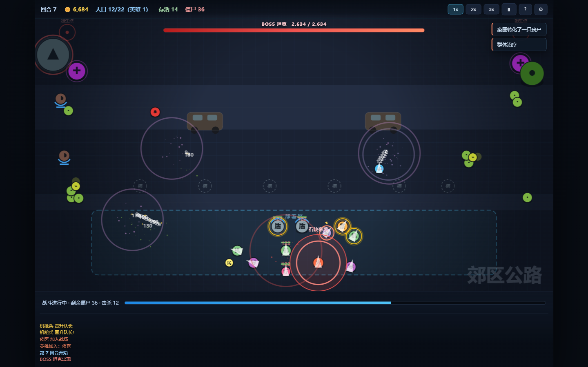

# 尸潮防线（Zombie Defense）

一款 **2D 圆形单位、人类 vs 僵尸的无尽防守游戏**。从主菜单进入无尽模式、选一张战区，开场演出后在地图任意合法位置自由布阵；人类小队会以盾兵为核心自主结阵、搜索并接敌；僵尸从四面屏幕外涌入。用击杀收入扩军、自由建造、升科技，尽可能活过更多回合。

- **开始流程**：主菜单（无尽 / 剧情占位 / 图鉴 / 设置）→ 选图（战区简报）→ 4.2s 开场演出（可跳过）→ 整备。
- **战前布阵，开战全自动**：战斗中只可暂停 / 加速；人类会自主搜索、结阵、寻医、闪避狂尸冲刺，闪避/治疗后归队。
- **零依赖、零构建**：双击 `index.html` 即玩。
- **8 人类 / 6 僵尸 + 幼体 + BOSS / 4 英雄 / 6 建筑 / 3 地图 / 47 节点科技树**。
- **手机自适应**：横屏优先；无法锁定横屏时竖屏同样可玩，HUD 与弹窗支持安全区滚动。
- **PWA**：可安装到主屏、离线可玩（需 HTTPS）。

**在线游玩：<https://charanie.github.io/zombie-defense/>**



## 运行

最简单：双击 `index.html`。

本地静态服务器（推荐用于测试 PWA / Service Worker）：

```bash
python -m http.server 8765
# 打开 http://127.0.0.1:8765/
```

`?dev=1` 会跳过 Service Worker，避免开发时缓存干扰。

## 安卓 APK（手机安装）

[`dist/zombie-defense-v1.6.0.apk`](dist/zombie-defense-v1.6.0.apk)（约 0.36 MB）是打包好的安卓安装包：单 Activity + WebView，
游戏资源全部内置，**不需要网络、不申请任何权限**。

- 直接下载：<https://charanie.github.io/zombie-defense/dist/zombie-defense-v1.6.0.apk>
- 安装：把 APK 传到手机（数据线 / 微信文件传输 / 网盘均可）→ 点开安装 → 允许“安装未知来源应用”。
- 要求：Android 7.0（API 24）及以上；横屏锁定；包名 `com.charanie.zombiedefense`。
- 说明：自签名（v2 + v3），可直接侧载，不是应用商店包；图标暂用系统默认图标。

重新打包（需要 JDK 17 + Android SDK build-tools 34 + python 的 `jpype1`）：

```powershell
python tools\android-build\build_apk.py     # 或双击 apps\zombie-defense-android\build-apk.cmd
```

细节与取舍见 [`apps/zombie-defense-android/README.md`](apps/zombie-defense-android/README.md)。

## 怎么玩

1. 主菜单选 **无尽模式**，在三张战区里挑一张：**郊区公路**（1★）、**医院广场**（2★）、**地铁站台**（3★）；点卡即进入，播放开场演出（0.35s 后按任意键可跳过）。
2. 整备期：点兵种卡 → 在地图任意合法位置点击放置；建筑页选卡 → 在任意空位建造（围墙可按 R 切换横/竖）；点「科技树 (T)」在 4 分支 × 6 层 × 47 节点中购买永久强化。
3. 点 **开始回合**：僵尸从四面屏幕外分批涌入，人类自动索敌开火；以盾兵为核心结阵，盾兵在前、远程/治疗在后；没有敌人时主动向待出生边缘搜索，受伤/感染后自己去找医疗站或治疗兵，闪避后归队。
4. 清场后结算：存活回 30% 血、平民 +12 金、通关奖励；每 3 回合晋升队长，每 7 回合 BOSS 出现。
5. 人类全灭即失败；无尽模式，尽可能活得更久。失败后可“再来一局”（1.0s 快速开场）或“返回选图”。

### 操作

| 输入 | 作用 |
|---|---|
| ↑ / ↓ | 主菜单里移动导航焦点 |
| Enter | 进入当前项 / 进入选中地图 |
| ← / → | 选图页切换卡片 |
| Esc | 逐层返回；过场中跳过（0.35s 后） |
| 鼠标左键 | 选卡 / 放置 / 选中 / 拖动已有人类 |
| 右键 / Esc | 取消选卡或放置 |
| 空格 | 暂停 / 继续 |
| 1 / 2 / 3 | 1x / 2x / 3x 速度 |
| Tab | 切换招募 / 建筑（仅游戏内） |
| T | 打开科技树（仅整备期） |
| M | 静音 |
| H | 图鉴 / 帮助 |
| R | 围墙横 / 竖切换 |

手机：点卡 → 点地图任意合法位置放置；点单位选中；选图页可横向滑动卡片；首次点按会尝试全屏横屏，失败则自动使用可玩的竖屏布局。



## 内容

| 系统 | 内容 |
|---|---|
| 开始流程 | 主菜单（4 项导航 + 战区监视）、无尽选图（3 张战区卡 + 行动简报）、剧情模式封存档案占位、4.2s 开场演出 |
| 人类 | 手枪、霰弹、机枪、喷火、导弹、盾兵、治疗、平民 |
| 僵尸 | 普通、狂尸、盾尸、爆尸、母体、巨人、幼体 |
| BOSS | 坦克（投石/践踏）、裂爪（冲刺/硬直）、腐吐者（三弹/毒云）、母巢（孵化/光环） |
| 英雄 | 长官（导弹支援）、武士（剑气）、加特林（鼓舞）、疫医（转化/群体治疗） |
| 建筑 | 围墙（横/竖）、哨塔、医疗站、弹药库、减速陷阱、地雷阵；每种有数量上限 |
| 科技 | 火力（20）/ 经济（8）/ 生命（8）/ 英雄（11），T1–T6 共 47 节点；8 职业被动 + 主动技、四英雄强化、范围治疗/导弹轰炸援助 |
| 特殊 | 感染、死亡转化、护盾、盾尸拦截、爆尸引信、母体爆仔、BOSS 池轮换、BOSS 石块侧移/冲刺预警/毒云/孵化光环、队长晋升、英雄重伤回归、人类小队搜索/结阵/寻医/闪避冲刺、复活/尸爆/存款加伤 |




## 开发

```bash
npm test                    # Node 内置测试（292 项）
node tests/bench.js         # 300 僵尸 + 99 人类 + 100 投射物基准
node tests/bot.js --rounds 42 --seed 1
node tests/bot.js --rounds 42 --seed 1 --rocket-only   # 纯火箭兵平衡回归
node tools/make-icons.js    # 重新生成 PWA 图标与 OG 图
node tools/qa-shot.js <url> <out.png> --eval-file <js> # Edge headless 截图 / 脚本化走查
python tools/android-build/build_apk.py               # 重新打安卓 APK（产物在 dist/）
```

### 目录

```
zombie-defense/
  index.html                 入口 + 唯一脚本加载顺序
  styles.css                 HUD / 面板 / 弹窗 / 响应式
  menu.css                   主菜单 / 选图 / 剧情弹窗 / 开场演出
  manifest.webmanifest       PWA 清单
  sw.js                      Service Worker（Cache First）
  icons/                     192 / 512 / maskable / OG
  shots/                     README 与 QA 截图
  src/
    core/                    常量、RNG、事件、几何、状态、平台
    data/                    人类、僵尸、英雄、建筑、地图、菜单、波次、公式
    sim/                     空间哈希、寻路、AI、战斗、感染、经济、模拟、活动区
    view/                    视图模型、Canvas 渲染、粒子、音效、HUD、输入、
                             开始流程（menuScene / menu / intro）、地图层与特效
    main.js                  启动、开始流程编排、主循环、输入回调、PWA
    test-hooks.js            window.__game
  tests/                     node:test + load-sim + bot + bench
  tools/                     图标生成、qa-shot（Edge headless 截图）、android-build（APK 构建）
  apps/zombie-defense-android/  Android WebView 壳 + APK 构建说明
  dist/                      打好的 APK
  docs/                      设计计划书、实现方案、STATE、ADR、平衡记录
  qa/checklist.md            QA 验收清单
```

### 架构要点

- 经典 `<script>` + `window.ZG` 命名空间；`tests/load-sim.js` 解析 `index.html`，保证加载顺序是唯一真相。
- `src/sim` 纯逻辑、固定 1/60 秒步长、随机走种子流；同种子 + 同整备期命令可复现。
- 32px 导航网格 + 人类源动态 BFS 流场；64px 空间哈希；双层 Canvas。
- 开始流程：`Menu` / `Intro` 不各自起 RAF，由 `main.loop` 的 `tick(nowMs)` 驱动；`showMenu`（菜单）与 `inputLocked`（过场）分离，`input.js` 统一 `gameplayBlocked()` 拦截。
- 300 僵尸基准：Node 模拟 ≈1.8ms/步（预算 2.5ms）；流场每 15 步重建，小队每秒重排。

## 发布

已部署：<https://charanie.github.io/zombie-defense/>（GitHub Pages，`main` / root）

```bash
git init
git add .
git commit -m "feat: zombie defense v1.0.0"
git remote add origin git@github.com:charanie/zombie-defense.git
git push -u origin main
```

本机 `github.com:443` 被阻断，**必须使用 SSH 推送**。push 后在仓库 Settings → Pages 选择 `main` / root。HTTPS 生效后 Service Worker、安装提示与离线缓存才会启用。

## 文档

- 设计计划书（唯一玩法真相）：[`docs/game-plan.md`](docs/game-plan.md)
- 实现方案：[`docs/superpowers/plans/2026-10-18-zombie-defense-implementation.md`](docs/superpowers/plans/2026-10-18-zombie-defense-implementation.md)
- 当前状态：[`docs/STATE.md`](docs/STATE.md)
- 平衡与性能：[`docs/balance-notes.md`](docs/balance-notes.md)
- QA：[`qa/checklist.md`](qa/checklist.md)

## 已知限制

- 宽屏手机的左右区域由背景填充，世界等比居中，不再是硬黑边。
- 音效为 Web Audio 程序生成，尚未在真机做音量/延迟验收。
- 首版无中途存档、在线排行榜、成就系统。
- 桌面 Electron/Tauri、手机 Capacitor、Steam 为后续可选路线。

## 版本

**v1.6.0**（2026-10-27）— 开始界面重做：主菜单（无尽/剧情占位/图鉴/设置 + 战区监视）、无尽选图（三张战区卡 + 行动简报）、4.2s 程序化开场演出（可跳过，重开 1.0s）；修掉菜单死按钮、弹窗层级、键盘穿透三个旧 bug；新增“上次抵达”记录与“开场动画”开关；新增安卓 APK 壳（`dist/zombie-defense-v1.6.0.apk`）。

**v1.5.0**（2026-10-27）— 地图细节与特效：三张地图重做（`MapLayer` 静态层 + 缩略图）、地铁双通道活动区（`MapZone`）、只从西侧隧道出怪、区域感知寻路；英雄技能与 BOSS 特殊攻击的分层特效（预警/过程/命中）。

**v1.4.0**（2026-10-22）— 科技树重做：4 分支 × 6 层 × 47 节点、8 职业被动/主动技、四英雄强化、范围治疗/导弹轰炸手动援助、复活/尸爆/存款加伤；科技页改为桌面四列/手机横滑大窗口。

**v1.3.0**（2026-10-22）— BOSS 体系：坦克投石 7s/2.5s 首发；新增裂爪（冲刺+硬直）、腐吐者（三弹+毒云）、母巢（孵化+光环）；R7 起四只 BOSS 池轮换且不连续重复。

**v1.2.0**（2026-10-19）— 人类小队自主搜索/结阵、全图自由布阵、建筑自由摆放与数量上限、僵尸四面来袭、盾尸拦截、盾兵破盾手枪、手机横竖屏自适应。

**v1.1.0**（2026-10-18）— 人类自主 AI：追击、寻医、闪避狂尸冲刺。
