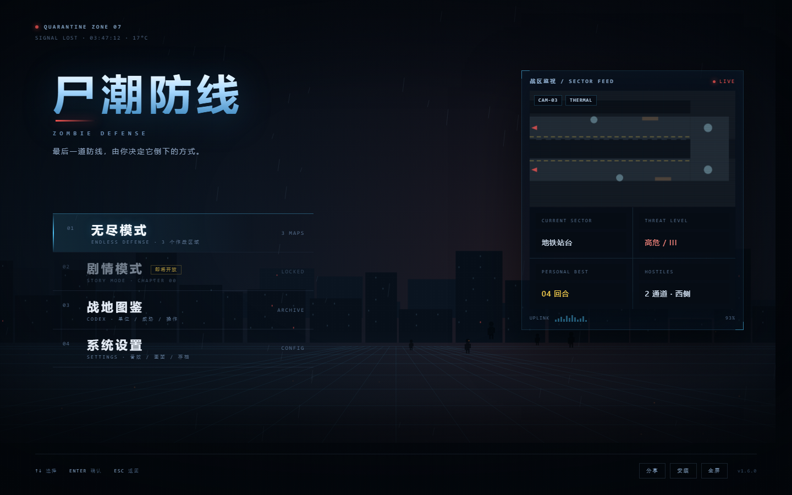
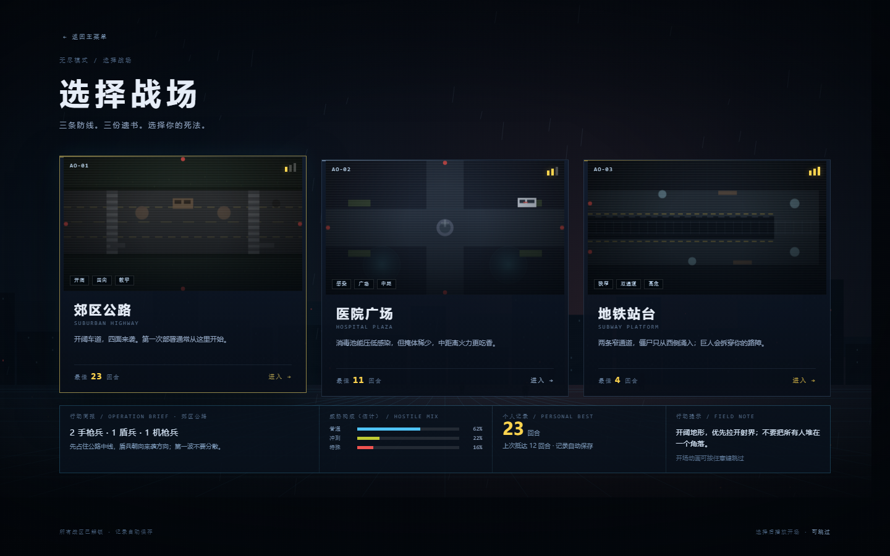
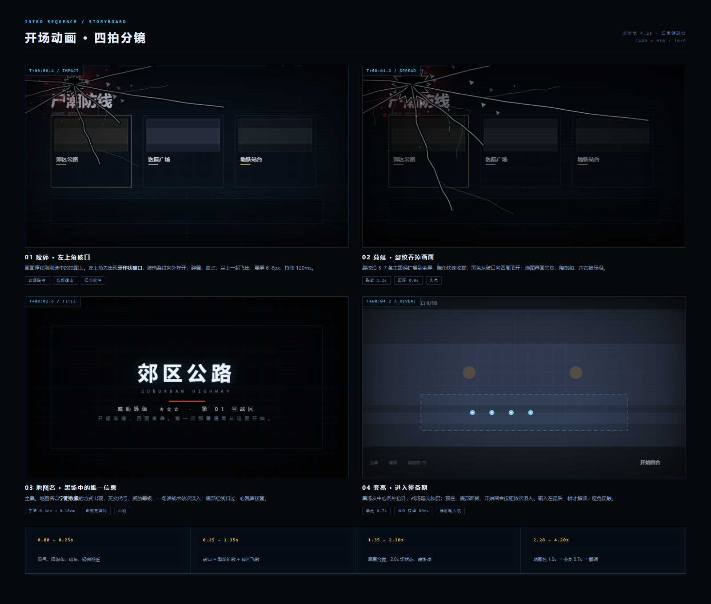
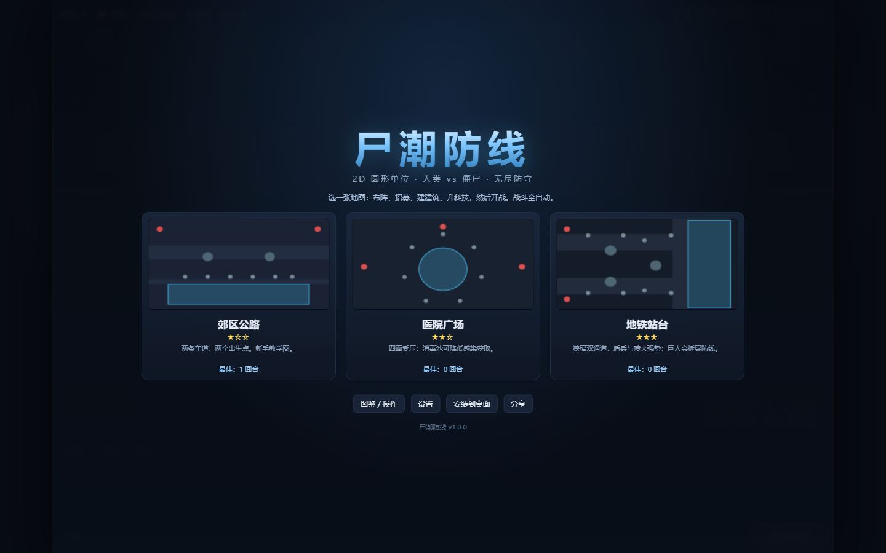

# 开始界面重做 · 无尽选图 · 开场演出 实施计划

> **状态**：设计评审稿（2026-10-27），尚未改动运行代码。
>
> **目标版本**：v1.6.0（若 v1.5 不先合并，则本计划顺延为 v1.5.0；发布前统一三处版本号）。
>
> **基线**：`main` @ v1.4.0，231 项测试全绿；`feat/v1.5-map-fx` 已 267 项全绿但未合并。
>
> **设计稿**：`docs/design/menu-mockup.html`、`docs/design/intro-storyboard.html`。
>
> **一句话目标**：把“三张卡片”的选图页，换成一个有主菜单、有战区简报、有入场仪式的游戏开始流程；剧情模式先以“封存档案”占位，结构上为后续章节留好接口。

---

## 0. 结论先行

这次不是“给菜单换皮”，而是把开始流程拆成三层：

1. **主菜单**：左侧纵向导航（无尽模式 / 剧情模式 / 战地图鉴 / 系统设置），右侧“战区监视”动态画面，底部工具条。第一眼是游戏，不是网页。
2. **无尽模式选图**：三张战区卡 + 悬停/聚焦时更新的“行动简报”（推荐开局、威胁构成、个人最佳、场地提示）。点卡即进入，不增加二次确认。
3. **开场演出**：点图后，画面左上角被咬碎 → 裂纹蔓延 → 黑场 → 地图名 → 曝光恢复 → HUD 错峰入场 → 解锁输入。全程 4.2 秒，0.35 秒后任意键/点击可跳过。

剧情模式这次**只做入口与封存档案弹窗**，不做章节、对话、关卡数据。菜单结构按“模式 → 关卡/地图”设计，后续加剧情时不需要再推翻主菜单。

---

## 1. 视觉方向

### 1.1 设计稿







> 设计稿是方向稿：字号、间距、卡片比例以本文件第 3–5 节的数值为准；截图里的英文小字、时间、信号条都是氛围信息，不是玩法数据。

改造前（v1.0 截图；v1.4 的菜单结构未变，仍是“标题 + 三张卡 + 四个按钮”）：



### 1.2 关键词

- **战术终端**：网格、坐标、扫描线、监控画面、红色威胁标记。
- **低照度**：主色仍是游戏里的深海军蓝 + 青蓝，少量血红与琥珀金做强调；不做彩色大图。
- **平面矢量**：和游戏内圆形单位、色块地图保持同一套语言；不引入写实照片、外部字体、外部图片。
- **克制**：菜单只做“选择”，不塞公告、签到、广告位。一个屏幕只保留一个主行动。

### 1.3 与现有 HUD 的关系

现有 HUD 是“深色面板 + 1px 细线 + 青色高亮 + 金色数值”。菜单沿用同一套 token，但把字号放大、留白拉开、动效放慢，形成“进入游戏前”的仪式感。

---

## 2. 现状诊断

| # | 现象 | 位置 | 根因 / 影响 |
|---|---|---|---|
| 1 | 开始页只有标题 + 三张地图卡 + 四个按钮 | `src/view/hud.js:284-322`；`styles.css:394-452` | 信息层级只有一层；剧情模式没有位置；不像“游戏主菜单” |
| 2 | 地图卡缩略图是手绘的 roads / obstacles / 四个红点 | `hud.js:324-343` | 三张图看起来都像色块；没有战区感 |
| 3 | 点地图立即 `startGame`，没有转场 | `main.js:274`、`185-193` | 从菜单到战场的切换生硬；没有“入场”记忆点 |
| 4 | 菜单里的“图鉴 / 操作”“设置”按钮实际是死的 | `hud.js:531-540` | `HUD.render` 在 `ui.showMenu` 时提前 `return`，永远不会执行到 621 行的 modal 显隐 |
| 5 | 即便修了 4，设置弹窗也会被菜单盖住 | `styles.css:382`（overlay z 40）vs `:395`（menu z 60） | 菜单和弹窗没有统一的层级表 |
| 6 | 菜单打开时按 Space / H / T / Tab 会触发游戏操作 | `input.js:251-289` | 键盘处理没有判断 `showMenu`；`Tab` 还被全局劫持为“切换招募/建筑”，会破坏菜单键盘导航 |
| 7 | 菜单卡片是 `div`，不可聚焦 | `hud.js:295` | 键盘与读屏用户无法操作 |
| 8 | 最佳记录只在菜单里刷新，没有“上次抵达” | `hud.js:532-537`；`platform.js` | 战区简报缺少“我上次打到哪”的信息 |
| 9 | 版本号 / SW 缓存停留在 v1.4.0 | `constants.js:51`、`sw.js:2`、`package.json` | 发版时必须同步，否则用户看到旧菜单 |
| 10 | v1.5 的 `ZG.MapLayer.drawMinimap` 已经能画详细地图，但未合并 | `feat/v1.5-map-fx` | 菜单缩略图本可以直接复用；不合并则要自己画一套 |

**结论**：菜单的问题不只是“不好看”，还有三个真实 bug（死按钮、层级、键盘穿透）。这次一并修，否则新菜单只是把旧问题包得更漂亮。

---

## 3. 信息架构与流程

### 3.1 屏幕图

```
BOOT
 └─ 主菜单 main
     ├─ 无尽模式 ──→ 选图 maps ──→ 点地图 ──→ 开场 intro ──→ 整备 prep ──→ 战斗 …
     ├─ 剧情模式 ──→ 封存档案 teaser（本次只到这一步）
     ├─ 战地图鉴 ──→ HUD 图鉴/帮助 modal（复用现有内容）
     └─ 系统设置 ──→ HUD 设置 modal（复用，新增“开场动画”开关）

GAME OVER
 ├─ 返回选图 ──→ maps
 └─ 重开 ──→ quick intro ──→ prep（同一张图）
```

### 3.2 状态机

| 当前 | 触发 | 下一状态 | 返回行为 | 输入 |
|---|---|---|---|---|
| main | 点“无尽模式” | maps | Esc → main | 菜单键盘 |
| main | 点“剧情模式” | teaser | 关闭 → main | 菜单键盘 |
| main | 点“图鉴/设置” | modal | 关闭 → main | 弹窗焦点 |
| maps | 点地图卡 | intro | 不可返回（已确认进入） | 锁定 |
| maps | Esc / 返回 | main | — | 菜单键盘 |
| intro | 播放到 1.90s | 建局，菜单隐藏 | 不可返回 | 锁定 |
| intro | 跳过 | 快速建局 + 短标题 + 曝光 | 不可返回 | 解锁在结束帧 |
| prep | 整备 | 战斗 | — | 游戏输入 |
| over | 返回选图 | maps | — | 菜单键盘 |

### 3.3 页面状态归属

- `Menu` 自己持有 `page: 'main' | 'maps' | 'hidden'`，不写进模拟状态。
- `state.ui.showMenu` 继续作为“菜单/过场正在挡住游戏”的兼容标志，`input.js` 与教程渲染都读它。
- 新增 `state.ui.inputLocked`：过场期间为 `true`。`showMenu` 管菜单，`inputLocked` 管过场；两者分离，跳过/重开时不会互相污染。
- 模拟层、`state.rng`、快照、确定性完全不受影响。

---

## 4. 主菜单详细设计

### 4.1 桌面布局（≥ 1100 × 700）

以 1440 × 900 为基准：

| 区域 | 位置 / 尺寸 | 内容 |
|---|---|---|
| 左上角标 | left 64, top 44 | 红点 + `QUARANTINE ZONE 07`；下一行 `SIGNAL LOST · 03:47:12 · 17°C` |
| 标题区 | left 96, top 132 | `尸潮防线` 78px / 字距 .12em；英文 `ZOMBIE DEFENSE` 11px / 字距 .58em；一句话 tagline |
| 主导航 | left 96, top 388, width 474 | 4 行，每行 70px；序号 01–04、中文 22px、英文小字、右侧状态 |
| 战区监视 | right 88, top 128, width 404 | 16:9 地图画面 + 4 格遥测 + UPLINK 信号条 |
| 底部条 | left/right 64, bottom 30 | 左：键盘提示；右：分享 / 安装 / 全屏 / 版本号 |

标题与导航之间用一条 74px 红色短线（`#EF5350`）做视觉锚点，不做大面积红色。

### 4.2 导航项规格

| # | 中文 | 英文 | 右侧 | 状态 | 行为 |
|---|---|---|---|---|---|
| 01 | 无尽模式 | ENDLESS DEFENSE · 3 个作战区域 | `3 MAPS` | 可用 | → maps |
| 02 | 剧情模式 | STORY MODE · CHAPTER 00 | `LOCKED` | 锁定，金色“即将开放” | → teaser |
| 03 | 战地图鉴 | CODEX · 单位 / 威胁 / 操作 | `ARCHIVE` | 可用 | → HUD help |
| 04 | 系统设置 | SETTINGS · 音效 / 画面 / 存档 | `CONFIG` | 可用 | → HUD settings |

交互：

- hover / focus：背景从左侧起 13% 青色渐隐；左侧 2px 光条；文字右移 8px；右侧状态变青。
- 锁定项：整体 62% 不透明度；hover 时不位移，只把“即将开放”标签提亮；点击仍打开 teaser，不是死按钮。
- 键盘：`↑/↓` 在导航项之间移动焦点，`Enter` 激活，`Esc` 无操作；`Tab` 走浏览器原生焦点顺序，不再被游戏截获。
- 触控：整行 44px 以上；点击即进入；hover 效果降级为 `:active` 的 80ms 高亮。

### 4.3 战区监视面板

不是装饰图，而是“当前地图的监控画面”：

- 画布比例 16:9，内容为 `ZG.MapLayer.drawMinimap`（v1.5+）或 `MenuScene.drawFallbackThumb`。
- 叠加：`CAM-03`、`THERMAL` 角标、扫描线、右上 `LIVE` 红点、红色入口标记、四角细线框。
- 每 7 秒在三张地图之间切换一次；切换用 280ms 的横向故障（画面错位 2–3px + 亮度闪一下），不是淡入淡出。
- 下方 2×2 遥测：当前战区 / 威胁等级 / 个人最佳 / 敌对通道；数值来自地图数据和 `Platform`。
- 底部 UPLINK 条：纯氛围，数值固定 93%，不模拟真实网络。

移动端（< 1100）隐藏该面板，把“当前战区”信息压缩进底部一行小字。

### 4.4 背景场景

`MenuScene` 在 `<canvas>` 上程序化绘制，不加载任何图片：

1. 垂直渐变夜空（`#050A12 → #0A1420 → #05080D`）。
2. 两层城市剪影：远层更暗、更矮，近层有零星窗灯（青、极少数红）。
3. 地面透视网格：地平线在 70% 高度，横线按幂次加密，竖线汇聚到消失点。
4. 三层雾带：正弦漂移，透明度 3.5%–6%。
5. 雨：95 条 1px 斜线，速度 900px/s，透明度 10%。
6. 余烬：26 个橙色小点，从地面缓慢上升。
7. 远处僵尸剪影：5 个“头 + 身体 + 两条腿”的极简人形，左右游荡，透明度 72%。
8. 扫描光带：每 30 秒横穿一次，透明度 3.5%。
9. 暗角、扫描线、颗粒由 CSS 叠层完成，避免每帧画全屏噪点。

`prefers-reduced-motion` 时冻结场景在固定帧（保留构图，不保留雨/雾/游荡），只保留静态暗角。

性能：背景是全屏 canvas，DPR 上限取 1.5（移动 1.25）；缩略图/监视画面可取 2，因为它们尺寸小。场景隐藏时停止绘制，不保留第二个 RAF。

### 4.5 底部工具条

- 左：`↑↓ 选择　ENTER 确认　ESC 返回`（10px 等宽）。
- 右：`分享`、`安装`（仅 `beforeinstallprompt` 可用时显示）、`全屏`、`v1.6.0`。
- 工具按钮 32px 高、10px 字，不做主按钮；主行动永远是左侧导航。

### 4.6 文案清单

| 位置 | 文案 |
|---|---|
| 标题 | 尸潮防线 |
| 英文 | ZOMBIE DEFENSE |
| tagline | 最后一道防线，由你决定它倒下的方式。 |
| 导航 01 | 无尽模式 / ENDLESS DEFENSE · 3 个作战区域 |
| 导航 02 | 剧情模式 / STORY MODE · CHAPTER 00（即将开放） |
| 导航 03 | 战地图鉴 / CODEX · 单位 / 威胁 / 操作 |
| 导航 04 | 系统设置 / SETTINGS · 音效 / 画面 / 存档 |
| 底部 | ↑↓ 选择　ENTER 确认　ESC 返回 |
| 监视头 | 战区监视 / SECTOR FEED |
| 版本 | 尸潮防线 v1.6.0 |

---

## 5. 无尽模式选图详细设计

### 5.1 布局

桌面以 1440 × 900 为基准：

| 区域 | 位置 / 尺寸 |
|---|---|
| 返回 | left 96, top 46，`← 返回主菜单` |
| 面包屑 | left 96, top 118，`无尽模式 / 选择战场` |
| 标题 | left 96, top 146，`选择战场` 50px / 字距 .18em |
| 副标题 | left 96, top 214，`三条防线。三份遗书。选择你的死法。` |
| 卡片行 | left/right 96, top 258；3 列，gap 24；每张约 384 × 380 |
| 行动简报 | left/right 96, top 656；4 列，高 108 |
| 底栏 | left/right 96, bottom 34 |

1366 × 768 时：标题 42px，卡片 top 236，简报 top 604，底栏 bottom 24；其余按比例压缩。

### 5.2 卡片结构

```
┌──────────────────────────────┐
│ AO-01                  ▂▄▆  │  ← 16:9 缩略图 + 编号 + 威胁条
│                              │
│  [开阔] [四向] [教学]         │
├──────────────────────────────┤
│ 郊区公路                      │
│ SUBURBAN HIGHWAY             │
│ 开阔车道，四面来袭。第一次…    │
│ ───────────────────────────  │
│ 最佳 23 回合          进入 →  │
└──────────────────────────────┘
```

- 卡片本身是 `<button>`，整卡可点。
- `AO-01/02/03` 来自 `mapOrder` 序号，不写死。
- 威胁条 3 格，填充数 = `map.difficulty`；颜色用该图 accent。
- 标签 3 个，来自 `ZG.Data.menu.mapBriefs[id].tags`。
- 描述沿用 `map.desc`，必要时在 data 里微调，不改玩法。
- 最佳记录来自 `Platform.loadBest(id)`；`0` 显示 `—`，不显示“0 回合”。
- hover / focus：整卡上移 6px，边框变 accent，缩略图亮度 +12%，右下 `进入 →` 变亮。
- 点击：卡片先闪 120ms（brightness 2.2），然后触发 `onSelectMap`；双击有 400ms 防抖。

### 5.3 缩略图

优先：

```js
ZG.MapLayer.drawMinimap(ctx, map, w, h);
```

v1.5 的缩略图已经包含主题底色、roads、地铁 zones、入口红点、障碍。菜单再叠三层：

1. 64px 网格（青色 7%）。
2. 扫描线（每 6px 一条 1.8% 白线）。
3. 暗角 + 底部渐变（保证卡片文字可读）。

如果运行环境没有 `ZG.MapLayer`（未合并 v1.5 的临时分支），回退到 `MenuScene.drawFallbackThumb`：用 `map.theme`、`map.roads`、`map.obstacles`、`map.terrain` 画一版简化缩略图。两条路径都只读地图数据。

### 5.4 行动简报

悬停/聚焦卡片时更新四格：

| 格 | 内容 | 数据 |
|---|---|---|
| 1 | 行动简报 · 地图名；推荐开局；一句场地注意 | `mapBriefs[id].loadout / note` |
| 2 | 威胁构成：普通 / 冲刺 / 特殊 三条横条 | `mapBriefs[id].mix`（展示用，不参与模拟） |
| 3 | 个人记录：最佳回合大数字；上次抵达 | `Platform.loadBest / loadLast` |
| 4 | 行动提示：一句战术建议；“开场动画可跳过” | `mapBriefs[id].tip` |

约束：

- `mix` 三项相加必须为 100；新增测试兜底。
- 文案只描述倾向，不承诺精确波次；避免和 `waves.js` 的真实构成打架。
- 触控端不显示简报面板（没有 hover）；把 `loadout` 以一行 10px 小字放进卡片 body，保证信息不丢。
- 简报更新用 `aria-live="polite"`，读屏能听到“已切换到地铁站台”。

### 5.5 地图 brief 初始数据

| 地图 | 推荐开局 | 场地注意 | 提示 | 构成（普通/冲刺/特殊） |
|---|---|---|---|---|
| 郊区公路 | 2 手枪兵 · 1 盾兵 · 1 机枪兵 | 先占住公路中线，盾兵朝向来袭方向 | 开阔地形，优先拉开射界；不要堆在一个角落 | 62 / 22 / 16 |
| 医院广场 | 2 手枪兵 · 1 霰弹兵 · 1 治疗兵 | 治疗兵放在消毒池边缘，优先点感染单位 | 掩体少，用建筑制造拐角，别让喷火兵贴脸 | 48 / 18 / 34 |
| 地铁站台 | 1 盾兵 · 2 喷火兵（第 2 回合补导弹兵） | 盾兵堵北通道，喷火覆盖南通道，导弹兵留到第 2 回合处理巨人 | 窄口是优势也是陷阱，两只盾兵不要叠在同一格 | 35 / 15 / 50 |

> 这些是“推荐”，不是强制配装；推荐开局都控制在初始 400 金内（地铁首发 360 金，导弹兵第 2 回合再补）。数值写在 `src/data/menu.js`，平衡改动时同步 review，但不参与任何公式。威胁构成是情报估计，不是精确波次。
>
> 兼容：上面的地铁文案按 v1.5 的“双通道、只从西侧出怪”写。如果 Task 0 决定不合并 v1.5，地铁简介改用 v1.4 的 `map.desc`（“狭窄双通道……巨人会拆穿防线”），地图卡视觉仍可用回退缩略图；其余不变。

### 5.6 选图页文案

| 位置 | 文案 |
|---|---|
| 返回 | ← 返回主菜单 |
| 面包屑 | 无尽模式 / 选择战场 |
| 标题 | 选择战场 |
| 副标题 | 三条防线。三份遗书。选择你的死法。 |
| 底栏左 | 所有战区已解锁 · 记录自动保存 |
| 底栏右 | 选择后播放开场 · 可跳过 |

---

## 6. 开场演出详细设计

### 6.1 设计原则

- **短**：4.2 秒；重开 1.0 秒；任何时候可跳。
- **有因果**：不是随机放个爆炸，而是“屏幕被咬穿 → 黑场 → 地图名 → 战场亮起”。
- **不挡操作**：0.35 秒后才允许跳过，避免手滑连点直接跳过；结束时才解锁输入。
- **不依赖素材**：裂纹、碎片、血点、黑幕全部 Canvas 程序化绘制；地图名用 DOM 文本，保证中文清晰。

### 6.2 时间轴（full，4.2s）

| 时间 | 阶段 | 画面 | 声音 | 输入 / 状态 |
|---|---|---|---|---|
| 0.00–0.25 | 吸气 | 菜单冻结；降饱和 15%；暗角 +8%；整体 scale 1.000→1.015 | 低频 rumble 起 | 锁定；`Intro.begin` |
| 0.25–0.35 | 破口 | 左上角 `(14%, 9%)` 出现牙印状黑口；6 条主裂纹起笔；碎屑、血点、尘土爆开；白闪 60ms；震屏 7px | 玻璃裂响 + 低频撞击 | 0.35 后显示“跳过” |
| 0.35–1.30 | 蔓延 | 裂纹进度 0.55→1；支裂纹展开；碎片下落；黑幕 alpha 0→0.6；菜单模糊 2px | 裂响尾音 + rumble | 锁定 |
| 1.30–1.95 | 黑幕 | 黑幕 alpha 0.6→1；边缘先黑，破口向外吞 | rumble 压闷 | 1.90：建局 + `Menu.hide()` |
| 1.95–2.30 | 黑场 | 全黑 0.35s；只有极轻的扫描线 | 心跳 2 下 | 锁定 |
| 2.30–3.10 | 地图名 | 地图名出现；英文代号、威胁等级、一句描述依次淡入；红线扫过 | 心跳 + 低频 stinger | 锁定 |
| 3.10–3.35 | 停顿 | 标题保持；字距从 0.6em 收到 0.18em 后停 | stinger 尾音 | 锁定 |
| 3.35–4.05 | 曝光 | 黑幕 alpha 1→0；白闪 40ms；HUD 顶栏/底栏/提示错峰滑入 | 上升 whoosh | 仍锁定 |
| 4.05–4.20 | 交接 | 最后一层黑幕消失；焦点交给游戏 | 静音 | 解锁，`Intro.done` |

阶段 id 固定为：`windup / impact / spread / blackout / hold / title / hold2 / reveal / settle`。`timeline()` 返回的 `phases` 按这个顺序，测试只依赖首尾与单调性，不锁死中间细分。

### 6.3 跳过与变体

| 变体 | 时长 | 内容 | 触发 |
|---|---|---|---|
| full | 4.2s | 上述完整流程 | 从选图进入 |
| skip | 0.55s | 直接全黑 80ms → 地图名 250ms → 曝光 220ms | 0.35s 后任意键 / 点击 / 点“跳过” |
| quick | 1.0s | 全黑 150ms → 地图名 450ms → 曝光 400ms | 游戏结束“重开” |
| reduced | 1.4s | 无裂纹/碎片/震屏；黑 200ms → 标题 800ms → 曝光 400ms | `prefers-reduced-motion` |
| off | 0.25s | 不加标题，直接 250ms 淡入 | 设置里关闭“开场动画” |

跳过实现：

- `Intro.skip()` 置 `skipped=true`；下一次 `tick` 把时间跳到 3.35s 的曝光段（如果还没建局，先建局）。
- 跳过不是“取消”，不返回菜单；已经点过地图 = 已确认。
- 跳过按钮放在右下角 44px 触控区，文案“跳过 ▸”；同时底部有 2px 进度线，随 4.2s 填满。
- 键盘：`Esc`、`Space`、`Enter` 都可跳过；触控：点任意位置；但 0.35s 前不响应。

### 6.4 破口与裂纹算法

所有几何都在归一化坐标里生成，`resize()` 时按当前画布尺寸重算；不写死像素。

**咬痕**

- 中心 `O = (0.14W, 0.09H)`。
- 26 个点围成一圈，半径在 `R` 与 `0.72R` 之间交替，另加 ±6% 抖动；`R = min(W,H) * 0.085`。
- 填充纯黑 `#010204`；外圈 1.4px 亮边 `rgba(235,245,255,.55)`；再叠一层 `rgba(239,83,80,.28)` 的径向红光。
- 破口边缘加 8–10 个“牙印”内凹，不能是规则圆。

**主裂纹**

- 6 条，角度以 `-0.35 + i*0.62` 为基准（偏右、偏下），每条 11 段。
- 每段方向加 ±0.35 rad 抖动；长度按 `len/11` 递减 25%；`len = 0.38–0.93` 的屏幕比例。
- 支裂纹概率 0.28，长度为主裂纹的 20%–45%，6 段。
- 绘制三层：4.4px 深色底 → 1.1px 亮边 → 0.8px 支裂纹；整体沿时间轴从起点向外“生长”。
- 主裂纹不能全部同角度；至少一条向左上、一条向下，形成包住屏幕的势能。

**碎片与血**

- 碎片 26 个：随机角度 + 距离 0.04–0.36 屏幕比例；三角形 2–9px；先亮后暗。
- 血点 10 个：暗红 `rgba(150,25,25,.5)`，半径 1–4px，距离 0.05–0.23。
- 尘土 12 个：灰白低透明圆，向外扩散。

**黑幕**

- 以破口为中心的径向渐变，内圈纯黑，外圈透明；半径从 0.2 屏扩到 1.5 屏。
- 另叠全屏黑色 alpha，0→1，保证任何比例下都能全黑。
- 在 1.90s 时强制 `alpha = 1`，再执行建局/隐藏菜单，避免闪出战场。

### 6.5 地图名层

DOM，不画在 canvas 上：

```
第 01 号战区 / SECTOR 01
郊区公路
SUBURBAN HIGHWAY
威胁等级 ★☆☆
开阔车道，四面来袭。第一次部署通常从这里开始。
```

- 地图名：`clamp(34px, 7.2vw, 86px)`，字重 900，字距 0.6em → 0.18em。
- 英文代号：10–11px，字距 0.5em，颜色 `#6E90B6`。
- 威胁等级：金色/红色星，配合文字，不只靠颜色。
- 红线：120px 宽、2px 高，从中间向两边展开。
- 进入时 80ms 的轻微故障：文字在 x 轴 ±1px 抖动两次，然后稳定；`prefers-reduced-motion` 关闭。
- 背景全黑，不显示地图缩略图；此时信息越少越好。

### 6.6 曝光与 HUD 入场

- 黑幕从中心向外抬升：`clip-path: circle()` 或 canvas 径向渐变反向；0.7s ease-out。
- 曝光同时给战场加 40ms 白色闪光（alpha 0.12），模拟“眼睛适应”。
- HUD 入场错峰：
  - 0ms：顶栏从 -12px 滑下；
  - 80ms：底部面板从 +18px 滑上；
  - 160ms：开始回合按钮/提示淡入；
  - 240ms：全部归位。
- HUD 入场用 CSS class `intro-reveal`；结束移除，避免影响后续战斗动画。
- 教程气泡在 `inputLocked` 为 true 时隐藏，曝光结束后才允许出现。

### 6.7 开场文案

| 位置 | 文案 |
|---|---|
| 左上小字 | 第 01 号战区 / SECTOR 01 |
| 主标题 | `map.name`（郊区公路 / 医院广场 / 地铁站台） |
| 英文 | `mapBriefs[id].codename`（SUBURBAN HIGHWAY / HOSPITAL PLAZA / SUBWAY PLATFORM） |
| 威胁 | 威胁等级 ★★☆ |
| 描述 | `map.desc` |
| 跳过 | 跳过 ▸ |

---

## 7. 剧情模式（本次只做占位）

### 7.1 入口

- 主菜单第二项，金色“即将开放”标签，右侧 `LOCKED`。
- 可点击，不置灰成死按钮；点击打开“封存档案”弹窗。

### 7.2 封存档案弹窗

内容：

```
档案封存 / CLASSIFIED
剧情模式 · 序章

撤离命令
指挥链已经断了。
你是最后一支还能收到命令的小队。

01 撤离命令        待解锁
02 隔离区          待解锁
03 巢穴            待解锁

剧情模式将在后续版本开放。        [返回]
```

- 弹窗 480–560px 宽，暗色档案纸质感（细横线、红色 `CLASSIFIED` 斜章）。
- 三章都是锁定态，不可点；用“待解锁”文字 + 锁图标，不只靠颜色。
- 不做“预约/通知”按钮，避免没有后端却给承诺。
- 关闭：`Esc`、点遮罩、点“返回”。

### 7.3 为后续剧情留的接口

本次只新增数据形状，不实现逻辑：

```js
// src/data/menu.js
ZG.Data.menu.story = {
  id: 'story',
  title: '剧情模式',
  chapterTitle: '序章：撤离命令',
  blurb: '指挥链已经断了。你是最后一支还能收到命令的小队。',
  chapters: [
    { id: 'ch01', name: '撤离命令', mapId: 'suburban', locked: true },
    { id: 'ch02', name: '隔离区', mapId: 'hospital', locked: true },
    { id: 'ch03', name: '巢穴', mapId: 'subway', locked: true }
  ]
};
```

后续做剧情时：

- 新增 `src/data/story.js`（章节、对话、目标）与 `src/sim/campaign.js`（目标判定），不改主菜单结构。
- `Menu` 的 `onSelectMode('story')` 从“开 teaser”换成“开章节选择”；地图卡组件可复用。
- 游戏状态将来可加 `mode: 'endless' | 'story'`、`chapterId`；本次不加，避免无用的字段进入快照/测试。

---

## 8. 技术架构

### 8.1 新增文件

| 文件 | 责任 | 分层 |
|---|---|---|
| `src/data/menu.js` | 模式列表、地图简报、剧情章节占位、菜单文案常量；纯数据 | data |
| `src/view/menuScene.js` | `ZG.MenuScene`：背景场景、缩略图回退、监视画面；纯绘制，顶层不碰 DOM | view |
| `src/view/menu.js` | `ZG.Menu`：DOM 结构、页面切换、导航/键盘/焦点、地图卡、简报、剧情弹窗 | view |
| `src/view/intro.js` | `ZG.Intro`：时间轴、裂纹几何、破碎/黑幕/曝光、跳过、声音触发 | view |
| `menu.css` | 菜单与开场样式；复用 `styles.css` 的 token | 样式 |
| `tests/menu.test.js` | 数据、布局纯函数、场景 stub 绘制 | test |
| `tests/intro.test.js` | 时间轴、裂纹几何、跳过、reduced motion | test |

> `tests/stub-ctx.js` 在 v1.5 已存在，直接复用；若从 v1.4 起步则本次新建。

### 8.2 修改文件

| 文件 | 改动 |
|---|---|
| `index.html` | `<link rel="stylesheet" href="menu.css">`；按顺序插入 `menuScene.js` / `menu.js` / `intro.js` |
| `styles.css` | 删除旧 `.menu` / `.menu-box` / `.game-title` / `.map-grid` / `.map-card` 等规则；统一 z-index 层级表；HUD 入场 class |
| `src/view/hud.js` | 删除 `buildMenu` / `drawMapThumb` / `refs.menu` / `refs.mapCards`；移除 `ui.showMenu` 的提前 return；设置弹窗加“开场动画”行；modal 层级修正 |
| `src/view/input.js` | 所有 pointer/keydown 入口先判断 `ui.showMenu || ui.inputLocked`；`Tab` 只在游戏内劫持 |
| `src/main.js` | 菜单/过场编排；`createRun` 与 `revealRun` 分离；`onSelectMap` 走 intro；`onRestart` 走 quick；`onMenu` 回选图；循环里 tick 菜单/过场；resize |
| `src/core/state.js` | `ui.inputLocked: false`；`settings.intro: true` |
| `src/core/platform.js` | `saveLast(mapId, round)` / `loadLast(mapId)` / `loadAllLast()` |
| `src/view/audio.js` | 新增 `glass` / `bite` / `impact` / `stinger` / `heartbeat` / `reveal` / `whoosh` 合成配方 |
| `sw.js` | SHELL 加入 `menu.css`、三个新脚本；CACHE 升版本 |
| `tests/shell.test.js` | 版本号三处一致（发布任务里改） |
| `docs/game-plan.md` | §1.4 非目标、§2.2 阶段表、§8.5 选图、§11 视觉、§13 路线图 |
| `docs/tech.md` / `docs/STATE.md` / `qa/checklist.md` | 模块、状态、验收清单 |
| `docs/architectural-decisions/0003-menu-and-intro.md` | 新增 ADR：菜单/过场架构、层级、输入锁 |

### 8.3 加载顺序（index.html）

```html
<link rel="stylesheet" href="styles.css">
<link rel="stylesheet" href="menu.css">
...
<script src="src/view/renderer.js"></script>
<script src="src/view/particles.js"></script>
<script src="src/view/audio.js"></script>
<script src="src/view/menuScene.js"></script>  <!-- 新增：只读 ZG.Data / ZG.MapLayer -->
<script src="src/view/menu.js"></script>       <!-- 新增：依赖 MenuScene / Audio -->
<script src="src/view/intro.js"></script>      <!-- 新增：依赖 Audio / Data -->
<script src="src/view/hud.js"></script>
<script src="src/view/input.js"></script>
<script src="src/main.js"></script>
```

规则：

- 三个新模块的顶层都不能访问 `document`、`window`、`localStorage`；DOM 只在 `init()` / `play()` 里创建。`tests/load-sim.js` 会把它们当普通脚本加载，一旦顶层碰 DOM 全量测试就红。
- `menuScene.js` 不能依赖 `menu.js`；`menu.js` 不能依赖 `intro.js`；`intro.js` 不反向依赖 `menu.js`。编排只在 `main.js`。
- `sw.js` 的 SHELL 与 `index.html` 同步加文件；`tests/shell.test.js` 会校验。

### 8.4 层级表（统一）

| 层 | z-index | 元素 | 说明 |
|---|---|---|---|
| 游戏背景 | 1 | `#game-bg` | |
| 游戏动态 | 2 | `#game` | |
| HUD | 3 | `#hud` | 整体 stacking context |
| 菜单 | 50 | `.menu-root` | 盖住 HUD |
| 弹窗 | 60 | `.overlay.modal` | 图鉴/设置/剧情 teaser；必须高于菜单 |
| Toast | 70 | `.toast-stack` | 保持现有值；高于弹窗 |
| Tooltip | 80 | `.tooltip` | 保持现有值；仅游戏内 |
| 开场 | 90 | `.intro-root` | 盖住菜单、HUD 与 Toast |

实现要点：

- 菜单和弹窗都放在 `#hud` 内部，共享 `#hud` 的 stacking context；不要挂到 `#stage` 外层，否则子元素 z-index 再大也压不过兄弟层。
- 旧 `.overlay` 40 → `.overlay.modal` 60；`.menu` 60 → `.menu-root` 50；Toast/Tooltip 保持 70/80，新增 `.intro-root` 90。
- `#hud` 的 `pointer-events: none` 保留；`.menu-root`、`.intro-root` 自己设 `pointer-events: auto`。
- `.menu-scene` 必须 `pointer-events: none`，否则全屏画布会吞掉导航点击；菜单内容层单独设 `pointer-events: auto`。
- `.intro-root` 需要接收点击用于跳过，保持 `pointer-events: auto`；内部的跳过按钮再单独设 44px 触控区。

### 8.5 模块接口

```js
ZG.Menu = {
  init(callbacks),                  // 建 DOM、场景 canvas、绑定键盘
  show(page),                       // 'main' | 'maps'
  hide(),
  page(),                           // 'main' | 'maps' | 'hidden'
  isVisible(),
  freeze(),                         // 过场开始时冻结场景画面 + 禁用菜单键盘/指针
  resize(),
  tick(nowMs),                      // 由 main 循环驱动；不可见时直接返回
  refreshRecords(),                 // 回到菜单时刷新 best/last
  refreshInstall()                  // PWA 安装可用时显示底部按钮
};
```

```js
ZG.Intro = {
  play(mapId, opts),                // opts: { variant, onBuild, onDone, settings }
  tick(nowMs),
  skip(),
  resize(),
  active(),
  timeline(variant, reduced)        // 纯函数，测试用；返回 [{id, start, end, ...}]
};
```

```js
ZG.MenuScene = {
  draw(ctx, w, h, nowMs, opts),     // 背景场景
  drawFeed(ctx, map, w, h, nowMs),  // 监视画面
  drawThumb(ctx, map, w, h),        // 缩略图（内部优先 MapLayer）
  drawFallbackThumb(ctx, map, w, h)
};
```

`ZG.Data.menu`：

```js
{
  modes: [
    { id: 'endless', name: '无尽模式', en: 'ENDLESS DEFENSE', available: true },
    { id: 'story',   name: '剧情模式', en: 'STORY MODE', available: false }
  ],
  mapBriefs: {
    suburban: { codename, tags, loadout, note, tip, mix: [62, 22, 16] },
    hospital: { ... },
    subway: { ... }
  },
  story: { ... }
}
```

### 8.6 主流程伪代码

```js
function openMenu(page) {
  state.ui.showMenu = true;
  state.ui.inputLocked = true;
  ZG.Menu.show(page || 'main');
}

function selectMap(mapId) {
  if (ZG.Intro.active()) return;         // 防双击
  state.ui.inputLocked = true;
  ZG.Menu.freeze();                       // 冻结场景，裂纹下是静帧
  ZG.Audio.init();                        // 用户手势内初始化音频
  ZG.Intro.play(mapId, {
    variant: 'full',
    settings: state.settings,
    onBuild: () => {
      state = newState(mapId);            // 建局发生在黑场 1.90s
      state.ui.showMenu = false;          // 黑幕已全黑，可以撤掉菜单
      state.ui.inputLocked = true;        // 但输入仍锁到曝光结束
      ZG.Menu.hide();
    },
    onDone: () => {
      state.ui.inputLocked = false;       // 只解锁输入；菜单已在黑场隐藏
    }
  });
}
```

- `onBuild` 建局并撤菜单，但**不解锁输入**；此时画面仍是全黑，HUD 不会闪。
- `onDone` 只做输入解锁；不要在这里才隐藏菜单，否则曝光阶段会看到菜单残影。
- `newState` 里的 `subscribe` / `applySavedSettings` 照旧；不新增模拟字段。
- `restartGame()` 用 `variant: 'quick'`，并立即 `newState`；`showMenu=false`、`inputLocked=true`，`onDone` 解锁。
- `onMenu()` 设置 `showMenu=true, inputLocked=true`，`Menu.show('maps')`，刷新记录。
- `onSelectMap` 由 `Menu` 回调触发；`Menu` 不直接改状态。

### 8.7 输入锁

`input.js` 所有入口统一：

```js
function gameplayBlocked(s) {
  return !s || s.ui.showMenu || s.ui.inputLocked;
}
```

- `pointermove` / `pointerdown`：阻塞。
- `keydown`：阻塞；但**先**处理“菜单里打开的 HUD 弹窗”：
  - 若 `s.ui.showHelp || s.ui.showSettings` 且 `Escape` → `onCloseModal()`，然后 return；
  - 这样从主菜单打开设置/图鉴后，Esc 仍能关闭弹窗，不会因为 `showMenu` 被一并挡掉。
- 菜单/过场自己的键盘监听仍工作（它们绑在 `document` 上，且在游戏监听之前/独立）。
- `Tab`：只有 `!blocked` 时才 `preventDefault` + 切换面板；菜单内 Tab 保持原生焦点移动。
- `H` / `T` / `Space` 等快捷键：过场/菜单内不响应。

`Menu` 键盘监听：

- 只在 `page !== 'hidden'` 且 `frozen === false` 时处理。
- 没有弹窗时：`↑/↓` 移动导航焦点；`←/→` 在选图卡片间移动；`Enter` 激活；`Esc` 从 maps 返回 main。
- 剧情 teaser 由 Menu 自己处理 `Esc` / 遮罩 / 返回；HUD 的图鉴/设置弹窗由 `input.js` 的 Esc 分支关闭，Menu 不重复处理。

### 8.8 设置新增项

`state.settings` 新增：

```js
intro: true   // 开场动画
```

设置弹窗新增一行：

```
开场动画     [开/关]
```

- 关闭后：选图 → 250ms 淡入，不播放裂纹/标题。
- 重开：默认 quick（1.0s）；若设置关闭开场动画，则改为 200ms 淡入。
- `prefers-reduced-motion` 是运行时覆盖，不写存档；优先级：系统 reduced > 设置 intro=false > full。
- `onToggleSetting` 已支持布尔值切换，不需要新分支。

### 8.9 记录

`Platform` 增加：

```js
saveLast(mapId, round)  // 写 zd_last_<id>，只增不减
loadLast(mapId)         // 读，异常返回 0
loadAllLast()
```

调用点：

- `ROUND_SETTLED`：`saveBest` 之后 `saveLast(s.mapId, p.round)`。
- `GAME_OVER`：同上。
- 选图页显示“上次抵达 N 回合”；`0` 显示“—”。

---

## 9. 视觉与样式细节

### 9.1 Token

```css
--menu-bg: #05080D;
--menu-ink: #E6EDF7;
--menu-dim: #8FA3BF;
--menu-faint: #566A85;
--menu-cyan: #4FC3F7;
--menu-red: #EF5350;
--menu-gold: #FFD54F;
--menu-line: rgba(79, 195, 247, .16);
--menu-panel: rgba(8, 14, 24, .72);
```

- 中文：`"Microsoft YaHei", "PingFang SC", "Noto Sans SC", system-ui, sans-serif`。
- 英文/数字：`ui-monospace, Consolas, "Courier New", monospace`。
- 不使用 `@font-face`、不引 Google Fonts。

### 9.2 字号阶梯

| 用途 | 桌面 | 移动 |
|---|---|---|
| 主标题 | clamp(52px, 5.4vw, 78px) | clamp(36px, 9vw, 48px) |
| 页面标题 | clamp(36px, 3.4vw, 50px) | 30px |
| 导航主字 | 22px | 19px |
| 卡片名 | 21px | 18px |
| 正文 | 12–13px | 11–12px |
| 英文小字 | 9–11px | 8–9px |

### 9.3 动效

| 元素 | 时长 / 曲线 |
|---|---|
| 导航 hover | 180ms ease-out |
| 主菜单 ↔ 选图 | 280ms cubic-bezier(.2,.7,.2,1)；main 左移 24px 淡出，maps 右移 24px 淡入 |
| 卡片 hover | 180ms；translateY(-6px) + 边框/阴影 |
| 卡片点击闪白 | 120ms |
| 监视切换 | 280ms 故障 |
| 场景 | 持续；`prefers-reduced-motion` 冻结 |
| 开场 | 见第 6 节 |

### 9.4 响应式

| 断点 | 变化 |
|---|---|
| ≥ 1100×700 | 完整双栏：左导航 + 右监视 |
| 900–1100 | 隐藏监视；导航宽 420；选图卡片改横滑 |
| < 900 或 coarse | 标题上移、导航全宽、底部工具条压缩；卡片横向 scroll-snap，单卡 82vw |
| 高 < 520（横屏手机） | 标题 28px、tagline 隐藏；导航 4×48px；卡片缩略图高 110px；简报隐藏 |
| 竖屏 390×844 | 标题 40px；导航 4×58px；选图卡片 82vw 横滑；底部工具条一行 |

移动端注意：

- `touch-action: pan-x` 只给卡片容器；页面本身不允许滚动。
- 安全区：底部 `env(safe-area-inset-bottom)`。
- 44×44px 最小触控；导航行高 ≥ 52px。
- 横屏高度不足时，优先保证“导航 + 开始”可见，监视面板直接隐藏。

### 9.5 可访问性

- 所有导航/卡片/工具按钮用 `<button>`，原生可聚焦。
- 页面切换时给非活动页加 `inert` + `aria-hidden="true"`，避免 Tab 进入不可见内容；280ms 过渡结束后再彻底隐藏。
- `:focus-visible`：2px 青色外框 + 2px offset；不能只靠 hover。
- 锁定项用 `aria-disabled="true"`，但仍可点开 teaser；文案说明“即将开放”。
- 地图卡 `aria-label`：`郊区公路，难度 1 星，最佳 23 回合，进入`。
- 简报更新 `aria-live="polite"`。
- 开场：`role="dialog" aria-label="进入战场"`；跳过按钮可 Tab 聚焦；`prefers-reduced-motion` 降级。
- 颜色之外有文字/形状：威胁等级同时有星和数字；锁定有“即将开放”文字。
- 对比度：正文 ≥ 4.5:1；大标题 ≥ 3:1。

---

## 10. 音频

在 `audio.js` 的 `NAMES` 增加：

```js
'glass', 'bite', 'impact', 'stinger', 'heartbeat', 'reveal', 'whoosh'
```

合成建议（全部复用现有 `noiseBuf` / `tone` / `sweep`）：

| 名字 | 配方 |
|---|---|
| glass | 3kHz highpass 噪声 0.25s + 2400Hz 正弦 0.08s |
| bite | 500Hz lowpass 噪声 0.35s + 90Hz saw 0.3s |
| impact | 55Hz 正弦 0.5s + 120Hz lowpass 噪声 0.2s |
| stinger | 55/58/110Hz 三个 saw，lowpass 1.2kHz，2s，音量 -12dB |
| heartbeat | 50Hz 正弦双脉冲，间隔 0.22s，重复 2 次 |
| reveal | 180→720Hz 正弦扫频 0.8s + 轻 whoosh |
| whoosh | 800→200Hz bandpass 噪声 0.5s，音量 -14dB |

约束：

- 首次用户手势（点地图）里 `Audio.init()`；不在页面加载时自动播。
- 静音/音量沿用 `Audio.setMuted`；过场不绕过。
- 新音效不能每帧创建节点；只在时间轴关键帧触发一次。
- 移动端音量整体 -3dB（可选，按 QA 决定）。

---

## 11. 任务拆解

> 每个任务结束都要 `node --test tests/*.test.js` 全绿；涉及浏览器可见改动的任务还要按第 13 节截图/走查。提交信息用 Conventional Commits。

### Task 0：基线、分支、v1.5 决策

**Files**：无（只读/分支）

- [ ] 确认 `main` 干净；记录 `npm test`、`node tests/bench.js`、`node tests/bot.js --rounds 42 --seed 1` 基线。
- [ ] 决策：是否先合并 `feat/v1.5-map-fx`。
  - **建议合并**：地图细节/缩略图/特效已完成且 267 测试全绿；菜单可直接用 `ZG.MapLayer.drawMinimap`。
  - 合并前把 worktree 里未提交的 `tests/policy.js` 改动一并 review 提交；v1.5 的版本号/STATE 收尾。
  - 若不合并：本计划从 `main` 拉 `feat/v1.6-menu-intro`，菜单用 `drawFallbackThumb`，版本号用 v1.5.0（与 v1.5 分支协调）。
- [ ] 拉分支：`git switch -c feat/v1.6-menu-intro`（或从 v1.5 合并后的 main）。
- [ ] 把 `docs/design/` 三份稿与本文档加入版本库。

**Acceptance**：分支就绪；基线数据记录在 `docs/STATE.md` 的“验证记录”草稿里。

---

### Task 1：先写设计与文档真相

**Files**：
- Modify：`docs/game-plan.md` §1.4 / §2.2 / §8.5 / §11 / §13
- Create：`docs/architectural-decisions/0003-menu-and-intro.md`
- Create：本文件

- [ ] §1.4 非目标改为：“剧情战役/关卡叙事仍不在本次范围；开场演出与主菜单骨架本次加入。”
- [ ] §2.2 阶段表增加“主菜单”“选图”“开场演出”三行；退出条件写清。
- [ ] §8.5 改写为“主菜单 → 无尽模式 → 选图 → 开场 → 整备”；保留三图全解锁、记录规则。
- [ ] §11 增加菜单/过场视觉与音效表；把“地图名/威胁等级”的字号、颜色写进去。
- [ ] §13 路线图把“剧情模式”从“非目标”移到“后续版本”。
- [ ] ADR-0003 记录：为什么用 DOM 菜单 + Canvas 场景/裂纹；为什么状态建局放在黑场；层级表；输入锁。

**Acceptance**：文档不再与实现方案矛盾；ADR 能让下一位代理直接照做。

---

### Task 2：菜单数据与记录存储

**Files**：
- Create：`src/data/menu.js`
- Modify：`src/core/platform.js`、`src/core/state.js`
- Test：`tests/menu.test.js`（先写数据部分）

**Interfaces**：见 8.5 的 `ZG.Data.menu`、`Platform.saveLast/loadLast`。

- [ ] 先写失败测试：

```js
// tests/menu.test.js
const { test } = require('node:test');
const assert = require('node:assert/strict');
const ZG = require('./load-sim.js')();

test('模式顺序与可用性', () => {
  assert.deepEqual(ZG.Data.menu.modes.map(m => m.id), ['endless', 'story']);
  assert.equal(ZG.Data.menu.modes[0].available, true);
  assert.equal(ZG.Data.menu.modes[1].available, false);
});

test('三张地图都有简报，且构成合计 100', () => {
  for (const id of ZG.Data.mapOrder) {
    const b = ZG.Data.menu.mapBriefs[id];
    assert.ok(b, id);
    assert.equal(b.mix.length, 3);
    assert.equal(b.mix.reduce((a, v) => a + v, 0), 100, id);
    assert.ok(b.loadout && b.note && b.tip, id);
  }
});

test('剧情占位三章都锁定', () => {
  const s = ZG.Data.menu.story;
  assert.equal(s.chapters.length, 3);
  assert.ok(s.chapters.every(c => c.locked));
});

test('last 记录只增不减', () => {
  const P = ZG.Platform.create({ storage: (() => {
    const m = {}; return { getItem: k => m[k] || null, setItem: (k, v) => { m[k] = String(v); }, removeItem: k => { delete m[k]; } };
  })() });
  P.saveLast('suburban', 8);
  P.saveLast('suburban', 5);
  assert.equal(P.loadLast('suburban'), 8);
  assert.equal(P.loadAllLast().suburban, 8);
});
```

- [ ] 实现 `menu.js`、`saveLast/loadLast/loadAllLast`、`settings.intro`、`ui.inputLocked`。
- [ ] 在 `main.js` 的 `ROUND_SETTLED` / `GAME_OVER` 里补 `saveLast`（可放到 Task 7 一起）。
- [ ] 跑全量测试。

**Acceptance**：数据层无 DOM；全量测试通过；`state.snapshot/hash` 不变。

---

### Task 3：`MenuScene` 背景与缩略图

**Files**：
- Create：`src/view/menuScene.js`
- Test：`tests/menu.test.js`（场景部分）
- Modify：`index.html`、`sw.js`

**Interfaces**：见 8.5。

- [ ] 先写 stub ctx 测试：

```js
const { stubCtx } = require('./stub-ctx.js');

test('三张地图缩略图都能画', () => {
  for (const id of ZG.Data.mapOrder) {
    const ctx = stubCtx();
    ZG.MenuScene.drawThumb(ctx, ZG.Data.maps[id], 384, 216);
    assert.ok(ctx.calls.fillRect + ctx.calls.arc + ctx.calls.stroke > 8, id);
  }
});

test('背景场景与监视画面不抛错', () => {
  const ctx = stubCtx();
  ZG.MenuScene.draw(ctx, 1440, 900, 0, {});
  ZG.MenuScene.drawFeed(ctx, ZG.Data.maps.subway, 376, 212, 0);
  assert.ok(ctx.calls.fillRect > 10);
});
```

- [ ] 实现步骤：
  1. `styleOf(map)` / `rgba()` 小工具；不允许顶层 DOM。
  2. `drawFallbackThumb`：底色、roads、terrain、obstacles、网格、扫描线、暗角、红点。
  3. `drawThumb`：若 `ZG.MapLayer && ZG.MapLayer.drawMinimap`，先用它铺底，再叠网格/扫描/暗角；否则回退。
  4. `draw`：夜空、双层天际线、透视网格、雾、雨、余烬、僵尸剪影、扫描光；固定 seed，时间只影响位移。
  5. `drawFeed`：16:9 缩略图 + 扫描线 + 入口箭头；不画文字（文字由 DOM 负责，保证清晰）。
- [ ] 加入 `index.html` 与 `sw.js`。
- [ ] 用 Edge headless 在 1440×900、1366×768 各截一张，确认不糊、不抢字。

**Acceptance**：stub 测试通过；浏览器缩略图能看清三张地图的布局差异；移动端不超 2ms/帧（DevTools Performance 抽样）。

---

### Task 4：主菜单 DOM 与导航

**Files**：
- Create：`src/view/menu.js`、`menu.css`
- Modify：`index.html`、`sw.js`
- Test：`tests/menu.test.js`（纯函数部分）

- [ ] DOM 结构（只列层级）：

```html
<div class="menu-root" data-page="main">
  <canvas class="menu-scene"></canvas>
  <div class="menu-fx vignette"></div>
  <div class="menu-fx scanlines"></div>
  <div class="menu-top">…QUARANTINE ZONE 07…</div>
  <section class="menu-hero">…标题 / 英文 / tagline…</section>
  <nav class="menu-nav">4 个 button.nav-item</nav>
  <aside class="menu-feed">…canvas + 遥测…</aside>
  <footer class="menu-bottom">…提示 / 工具 / 版本…</footer>
</div>
```

- [ ] `Menu.init(callbacks)` 建 DOM，绑定：
  - nav 的 `click` / `mouseenter` / `focus`；
  - 键盘 `↑↓ Enter Esc`；
  - 窗口 `resize`（或由 main 调 `resize`）。
- [ ] `show('main')` / `show('maps')`：切换 `data-page`，CSS 负责 280ms 过渡；`show` 时启动场景 tick，`hide` 时停止。
- [ ] `tick(nowMs)`：只有 `visible && !frozen` 时画场景；每 7 秒切换监视地图。
- [ ] `freeze()`：停止场景，保留最后一帧；`frozen=true` 时菜单键盘监听直接 return，内容层加 `.frozen`（`pointer-events:none`），避免过场期间在背后切页。
- [ ] `show()` / `hide()` 重置 `frozen=false`。
- [ ] `refreshRecords()`：读 best/last，更新监视与卡片。
- [ ] `refreshInstall()`：读 `ZG.__installPrompt`，显隐底部“安装”；`main.js` 在 `beforeinstallprompt` / `appinstalled` 后调用。旧菜单里由 `HUD.render` 负责这件事，现在归 Menu。
- [ ] 纯函数抽出来供测试：`menuLayout(w,h)` 返回断点/面板显隐；`navItems()` 返回顺序。

**Acceptance**：桌面主菜单与设计稿一致；`↑↓` 可切换焦点、`Enter` 可进选图；菜单打开时按 `Tab` 不会被游戏截获。

---

### Task 5：选图页、卡片与行动简报

**Files**：
- Modify：`src/view/menu.js`、`menu.css`
- Test：`tests/menu.test.js`

- [ ] `page === 'maps'` 时渲染三张卡；卡片用 `<button>`，内含 `<canvas>` 缩略图。
- [ ] `drawThumb` 在 `requestAnimationFrame`/`tick` 首帧绘制一次；卡片尺寸变化时重绘（`ResizeObserver` 可选，或监听 `resize` 统一重画）。
- [ ] hover/focus 更新简报；`aria-live="polite"`。
- [ ] 点击卡片：
  - 加 `.flash` class 120ms；
  - 400ms 防抖；
  - 调 `callbacks.onSelectMap(id)`。
- [ ] 触控横滑容器：记录 pointerdown 坐标，位移 > 8px 时抑制随后的 click；卡片仍可正常点按。
- [ ] 选图页键盘：`←/→` 在卡片间移动，`Enter` 进入，`Esc` 返回 main。
- [ ] 移动端：卡片横向 scroll-snap；隐藏简报，卡片 body 显示一行推荐开局。
- [ ] 底栏记录：best/last 为空显示 `—`。

**Acceptance**：三张卡的最佳记录来自 localStorage；点卡 120ms 内有视觉反馈；双击只触发一次；触控横滑不触发点击。

---

### Task 6：HUD 与层级重构（修旧 bug）

**Files**：
- Modify：`src/view/hud.js`、`styles.css`、`src/view/input.js`
- Test：`tests/view.test.js`、`tests/shell.test.js`

- [ ] 删除 `buildMenu` / `drawMapThumb` / `refs.menu` / `refs.mapCards` / `installBtn` / `shareBtn` 的菜单用法；`HUD.init` 不再建菜单。
- [ ] `HUD.render` 去掉 `if (ui.showMenu) return;`；保留“更新 best”逻辑之前的部分？改为：
  - 先更新 modal 显隐（settings/help/settlement/gameover）；
  - 再更新顶栏/底栏（菜单挡住也无所谓）；
  - 最后更新教程（`showTut = tutorialStep >= 0 && !showMenu && !inputLocked && prep`）。
- [ ] 层级按 8.4 改；`.overlay.modal` 覆盖为 60；`.menu-root` 50；`.intro-root` 90；Toast/Tooltip 维持 70/80。
- [ ] 设置弹窗加“开场动画”行；`onToggleSetting('intro')` 走现有布尔分支。
- [ ] `input.js`：
  - 加 `gameplayBlocked(s)`；
  - pointermove/down/keydown 首行判断；
  - `Tab` 只在游戏内 `preventDefault`；
  - `Escape` 在菜单/过场里不做游戏操作。
- [ ] 手动验证：菜单 → 设置能打开且在最上层；改“开场动画”后刷新仍保留；菜单里按 Space/H/T 不触发游戏。

**Acceptance**：旧 bug 4/5/6 全部消失；全量测试通过；设置从菜单打开可见、可改、可关。

---

### Task 7：`Intro` 时间轴与裂纹

**Files**：
- Create：`src/view/intro.js`
- Modify：`src/view/audio.js`、`menu.css`、`index.html`、`sw.js`
- Test：`tests/intro.test.js`

**Interfaces**：见 8.5；`timeline(variant, reduced)` 纯函数。

- [ ] 先写时间轴/几何测试：

```js
test('full 时间轴单调且总长 4200ms', () => {
  const t = ZG.Intro.timeline('full', false);
  assert.equal(t.total, 4200);
  for (let i = 1; i < t.phases.length; i++) {
    assert.ok(t.phases[i].start >= t.phases[i - 1].end - 0.01);
  }
  assert.equal(t.phases[0].id, 'windup');
  assert.equal(t.phases[t.phases.length - 1].id, 'settle');
});

test('skip 变体不超过 600ms，reduced 不超过 1500ms', () => {
  assert.ok(ZG.Intro.timeline('skip', false).total <= 600);
  assert.ok(ZG.Intro.timeline('full', true).total <= 1500);
});

test('裂纹点都在画布内且可复现', () => {
  const a = ZG.Intro.crackPaths(20261027, 1440, 900);
  const b = ZG.Intro.crackPaths(20261027, 1440, 900);
  assert.deepEqual(a, b);
  assert.ok(a.length >= 6);
  for (const path of a) for (const p of path.pts) {
    assert.ok(p.x >= 0 && p.x <= 1440 && p.y >= 0 && p.y <= 900);
  }
});
```

- [ ] 实现 `timeline`：返回 `{ total, phases: [{id,start,end}] }`；full/skip/quick/reduced/off 五套。
- [ ] 实现 `crackPaths(seed, w, h)`：6 条主裂纹 + 支裂纹；固定种子，纯几何，不读 DOM。
- [ ] 实现 `play(mapId, opts)`：
  - 建 `.intro-root`：canvas + 黑幕层 + 标题 DOM + 跳过按钮 + 进度线；
  - 计算 `variant`：`settings.intro === false` → off；`matchMedia reduced` → reduced；否则 full/skip/quick；
  - `tick(nowMs)` 根据时间轴更新 canvas/DOM；
  - 在 1.90s 或跳过时调 `onBuild()`（一次性 guard）；
  - 结束时调 `onDone()`，移除 DOM、`active=false`。
- [ ] `skip()`：只置标志；下一次 tick 跳到曝光段；0.35s 前忽略。
- [ ] 音频：在 0.25/0.35/1.30/1.95/2.30/3.35 触发对应音效；静音/设置生效。
- [ ] 移动端：DPR cap 1.5；碎片 26→18；血点 10→6；关闭震屏（若 quality.mobile）。
- [ ] `resize()`：重算 canvas 尺寸与裂纹几何；标题用 CSS 自适应。

**Acceptance**：四个关键帧（0.4s / 1.2s / 2.6s / 4.1s）截图符合分镜；跳过在任何阶段都不卡死；reduced motion 无闪烁/震屏；结束帧输入解锁。

---

### Task 8：主流程编排

**Files**：
- Modify：`src/main.js`、`src/view/input.js`、`src/view/hud.js`
- Test：manual + 回归

- [ ] 拆 `startGame`：
  - `createRun(mapId)`：只建 state、设置 tutorial 初始值、`showMenu`/`inputLocked` 由调用方决定。
  - `revealRun()`：`showMenu=false`、`Menu.hide()`、`Audio.play('click')`。
- [ ] `selectMap` 走 8.6 伪代码；`onBuild` 在 1.90s；`onDone` 解锁。
- [ ] `restartGame()`：立即 `newState`，`Menu.hide()`，`Intro.play(id,{variant:'quick'})`；`onDone` 解锁。
- [ ] `onMenu()`：`showMenu=true`、`inputLocked=true`、`Menu.show('maps')`、`refreshRecords()`；关闭所有游戏内弹窗。
- [ ] 主循环：
  - 菜单可见时跳过 `Renderer.draw`（省 CPU），但仍 `HUD.render` 更新弹窗/Toast；
  - `ZG.Menu.tick(now)`；`ZG.Intro.tick(now)`；
  - 过场结束后正常绘制。
- [ ] `resize`：调 `Menu.resize()`、`Intro.resize()`；orientationchange 同样。
- [ ] 首次 `init()`：建一个占位 state（suburban），`showMenu=true`，`Menu.show('main')`；不自动播放 intro。
- [ ] `registerPWA` 的 `beforeinstallprompt` / `appinstalled` 回调里调用 `ZG.Menu.refreshInstall()`。
- [ ] 首局教学：intro 结束后才允许教程出现；`tutorialStep` 逻辑保持。

**Acceptance**：选图 → 开场 → 整备一气呵成；重开 1.0s；返回菜单是选图页；菜单/过场中所有游戏快捷键失效；退出过场后快捷键恢复。

---

### Task 9：剧情占位弹窗

**Files**：
- Modify：`src/view/menu.js`、`menu.css`
- Test：`tests/menu.test.js`

- [ ] `Menu` 内建 `.story-teaser`（或复用 `.menu-modal`），z 60。
- [ ] 点击“剧情模式”打开；显示 `ZG.Data.menu.story` 的标题、blurb、三章。
- [ ] 关闭：Esc、遮罩、返回按钮；焦点回到“剧情模式”项。
- [ ] 章节锁定：`aria-disabled` + “待解锁”文字；不可点。
- [ ] 文案按 7.2；不出现“预约/购买/登录”。

**Acceptance**：弹窗在菜单之上；键盘可关闭；读屏能读出“档案封存，剧情模式，序章，待解锁”。

---

### Task 10：响应式与可访问性打磨

**Files**：
- Modify：`menu.css`、`src/view/menu.js`
- Test：manual + screenshot matrix

- [ ] 1440×900、1366×768、1024×768、844×390、390×844 五档截图。
- [ ] 390×844：标题不换行溢出；导航 44px+；工具条不压安全区；选图横滑一次一张。
- [ ] 844×390：标题/导航/卡片都在首屏；不出现纵向滚动条。
- [ ] `prefers-reduced-motion`：场景冻结；开场 1.4s；无震屏。
- [ ] 键盘全程：Tab 顺序、方向键、Enter、Esc；焦点可见。
- [ ] 对比度抽查：导航、卡片描述、简报小字。
- [ ] 触控 44px 抽查：导航、卡片、工具、跳过、弹窗关闭。

**Acceptance**：五档无溢出/无遮挡；键盘可完成“进选图 → 选图 → 跳过开场”；reduced motion 可完成同一流程。

---

### Task 11：回归、QA、版本与发布

**Files**：
- Modify：`package.json`、`src/core/constants.js`、`sw.js`、`tests/shell.test.js`、`docs/STATE.md`、`qa/checklist.md`、`README.md`

- [ ] `npm test` 全绿；记录数量（v1.4 231 → v1.6 预计 245+）。
- [ ] `node tests/bench.js`：`avgStepMs` 不超过基线 115%。
- [ ] `node tests/bot.js --rounds 42 --seed 1`：回合数与 v1.5 基线一致（无 v1.5 则与 v1.4 一致）。
- [ ] 确定性：同 seed 两次 hash 一致；菜单/过场不消耗 `state.rng`。
- [ ] 浏览器 QA：
  - 桌面：主菜单 → 无尽 → 三图 hover → 点图 → 0.4/1.2/2.6/4.1s 截图 → 跳过 → 整备；
  - 手机竖屏/横屏：同上；检查安全区、横滑、44px；
  - 设置：从菜单打开、切“开场动画”、刷新保留；
  - 图鉴：从菜单打开、Esc 关闭；
  - 剧情：teaser 打开/关闭；
  - 返回菜单：游戏结束 → 选图；重开 → quick；
  - console 0 error；`file://` 双击可玩。
- [ ] 版本号三处一致：`package.json`、`ZG.Const.VERSION`、`sw.js` CACHE + shell test。
- [ ] `sw.js` SHELL 包含 `menu.css`、`menuScene.js`、`menu.js`、`intro.js`。
- [ ] 更新 `docs/STATE.md`（版本、测试数、性能、QA 记录、下一步）。
- [ ] 更新 `docs/tech.md` 的“新增模块”。
- [ ] 更新 `qa/checklist.md`：菜单/过场检查项。
- [ ] 部署 GitHub Pages；线上验证 `ZG.Const.VERSION`、缓存名、三图缩略图、开场。
- [ ] 可选：同步 `apps/zombie-defense-desktop/resources/app/game/` 并重新打包桌面版；在 STATE 里注明“桌面版未重打包”或已完成。

**Acceptance**：全部命令有输出证据；线上地址可玩；无 P0/P1 缺陷。

---

## 12. 验收标准

### 12.1 功能

- [ ] 主菜单 4 项可按设计工作；剧情模式弹窗正确；图鉴/设置从菜单可打开。
- [ ] 无尽模式 → 三张地图 → 点卡 → 开场 → 整备；全程无死路。
- [ ] 三张地图最佳/上次记录正确显示，刷新后保留。
- [ ] 开场 4.2s；跳过 ≤ 0.6s；重开 1.0s；设置关闭后 0.25s。
- [ ] 过场结束前输入锁定，结束后恢复；菜单内游戏快捷键不生效。
- [ ] 返回菜单回到选图页，不是主菜单。
- [ ] `file://` 双击可玩；PWA 缓存更新。

### 12.2 视觉

- [ ] 三个断点截图与设计稿同一构图；标题、导航、监视、卡片无错位。
- [ ] 缩略图能区分三张地图；地铁图能看到双通道+大厅。
- [ ] 开场四个关键帧：破口在左上、裂纹蔓延、黑场标题、曝光进入。
- [ ] 无外部图片/字体；无彩色大图；与游戏内 HUD 同一套颜色。

### 12.3 性能

- [ ] 菜单场景 ≤ 2ms/帧（1440×900，桌面）。
- [ ] 开场无 >50ms 长帧；移动端碎片 ≤ 18。
- [ ] 菜单隐藏后场景停止绘制；主循环不再画游戏 canvas。
- [ ] 20 次菜单↔游戏循环无 DOM/Canvas 泄漏（Performance Memory 抽样）。

### 12.4 可访问性

- [ ] 键盘可完成主菜单 → 选图 → 开始 → 跳过过场。
- [ ] `:focus-visible` 可见；`Esc` 逐层返回。
- [ ] `prefers-reduced-motion` 生效。
- [ ] 触控目标 ≥ 44px；颜色之外有文字/形状。
- [ ] 读屏能读出页面标题、地图卡标签、锁定状态、跳过按钮。

---

## 13. 风险与应对

| 风险 | 概率 | 影响 | 应对 |
|---|---|---|---|
| v1.5 合并冲突（maps.js / hud.js / renderer.js） | 中 | 中 | 先合并 v1.5 再拉 v1.6；菜单只新增文件，尽量少改 maps.js |
| 菜单/弹窗层级再次错乱 | 中 | 高 | 按 8.4 层级表一次性重排；每个弹窗 QA 从菜单打开 |
| 输入锁导致战斗快捷键失效 | 中 | 高 | `gameplayBlocked` 只判断 `showMenu/inputLocked`；过场结束显式置 false；手动回归 Space/1/2/3/T/H/Esc |
| 开场太长，重复游玩烦 | 中 | 中 | 4.2s + 0.35s 可跳 + 重开 1.0s + 设置关闭 |
| 手机掉帧 | 中 | 中 | DPR 1.5、碎片 18、场景隐藏即停、reduced motion |
| 裂纹看起来像“划痕”而不是“咬碎” | 中 | 高 | 破口用 26 点牙印 + 内凹 + 红光；碎片/血点/震屏；QA 看截图再调 |
| 中文标题在 canvas 上糊 | 低 | 中 | 标题用 DOM；canvas 只画裂纹/黑幕 |
| SW 缓存导致用户看到旧菜单 | 中 | 高 | 升 CACHE + 更新提示；发布后强制刷新验证 |
| `color-mix` 等新 CSS 不兼容 | 低 | 低 | 用 rgba/hex 变量；不依赖 `color-mix` 做关键样式 |
| 文件过多，加载顺序错 | 低 | 高 | 只加 4 个文件；`tests/load-sim.js` + `shell.test.js` 双保险 |

---

## 14. 需要你确认的 4 个选择

以下已按推荐方案写进计划；如果你有不同偏好，评审时直接改这 4 条即可，不影响其它部分。

1. **开场动画频率**：每次从选图进入都播完整 4.2s，可跳过；重开播 1.0s 短版。
   - 备选：仅首次进入每张图播完整版，之后自动短版。
2. **地图点击**：点卡即进入，不做二次确认；桌面 hover 看简报，触控看卡内一行推荐。
   - 备选：点卡选中 → 再点“进入战场”。
3. **剧情模式**：本次只做“封存档案”占位，不做一章试玩。
   - 备选：先做 1 张图 + 3 段文字的微型序章（会显著扩大范围）。
4. **v1.5**：建议先合并 `feat/v1.5-map-fx`，菜单直接复用 `MapLayer` 缩略图；否则菜单自带回退缩略图，版本号顺延为 v1.5.0。

---

## 15. 附：浏览器 QA 截图清单

| # | 状态 | 尺寸 | 检查 |
|---|---|---|---|
| 1 | 主菜单 | 1440×900 | 标题/导航/监视/工具条 |
| 2 | 主菜单 | 1366×768 | 不溢出、不压底 |
| 3 | 主菜单 | 390×844 | 竖屏导航、工具条 |
| 4 | 主菜单 | 844×390 | 横屏紧凑 |
| 5 | 选图 | 1440×900 | 三卡 + 简报 |
| 6 | 选图 | 390×844 | 横滑、单卡 82vw |
| 7 | 剧情 teaser | 1440×900 | 层级、锁定态 |
| 8 | 设置（从菜单） | 1440×900 | 在菜单之上、可切“开场动画” |
| 9 | 开场 0.4s | 1440×900 | 左上破口、碎片 |
| 10 | 开场 1.2s | 1440×900 | 裂纹蔓延、压暗 |
| 11 | 开场 2.6s | 1440×900 | 黑场地图名 |
| 12 | 开场 4.1s | 1440×900 | 曝光、HUD 入场 |
| 13 | 整备 | 1440×900 | 菜单已隐藏、输入可用 |
| 14 | 游戏结束 → 选图 | 1440×900 | 返回路径正确 |
| 15 | 重开 quick | 1440×900 | 1.0s 短版 |

---

## 16. 附：DoD（完成定义）

- [ ] 本文件所有 Task 勾选完成。
- [ ] `npm test` 全绿，数量写在 `docs/STATE.md`。
- [ ] `bench` / `bot` 无回归。
- [ ] 五档截图 + 四帧开场截图归档到 `qa/` 或 `docs/design/shots/`。
- [ ] 版本号三处一致，SW 缓存更新。
- [ ] 线上地址验证通过，console 0 error。
- [ ] `docs/game-plan.md`、`docs/tech.md`、`docs/STATE.md`、ADR-0003、`qa/checklist.md` 全部更新。
- [ ] 桌面版：已同步或明确标注“未重打包”。
